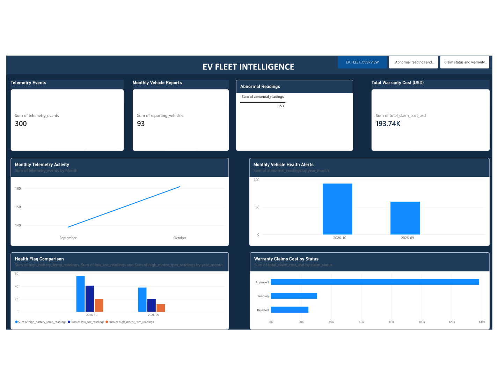
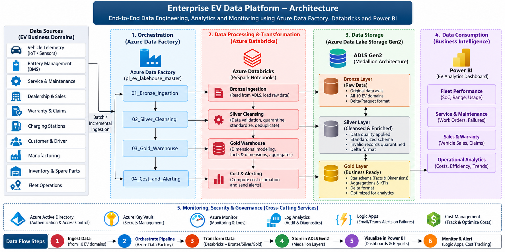
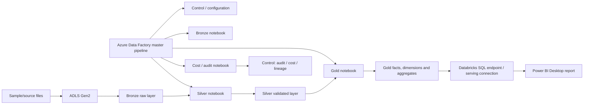

# Enterprise EV IoT Data Platform — Azure Data Engineering MVP

An end-to-end portfolio MVP demonstrating a lakehouse-style data pipeline for electric-vehicle (EV) telemetry, vehicle health, service and warranty reporting. The project combines Azure Data Factory (ADF), Azure Data Lake Storage Gen2 (ADLS Gen2), Azure Databricks/PySpark, Delta Lake and Power BI.

> **Evidence-first documentation:** this repository contains exported notebooks, sanitized ADF JSON, screenshots, the editable Power BI `.pbix`, and the 3-page Power BI report PDF supplied with the project. Some advanced capabilities are described as design opportunities rather than completed features. See [`docs/08_source_code_review.md`](docs/08_source_code_review.md) and [`docs/09_testing_and_known_gaps.md`](docs/09_testing_and_known_gaps.md).

## Business problem

EV fleet and engineering teams need to monitor telemetry volume, vehicle-health exceptions and warranty expenditure. This MVP creates a repeatable path from source files to curated analytical tables and a Power BI report.

## Dashboard preview



The supplied report PDF contains three pages:
1. **EV Fleet Intelligence** — telemetry events, monthly vehicle reports, abnormal readings, warranty cost, monthly telemetry activity, monthly health alerts, health flag comparison and claim cost by status.
2. **Vehicle Health Reports** — monthly alerts, abnormal readings, reporting-vehicle KPI and health-flag comparison.
3. **Warranty Claim Status** — health-flag comparison and total warranty cost.

See [`docs/powerbi/README.md`](docs/powerbi/README.md) and the original PDF at [`reports/powerbi/Enterprise_EV_Fleet_Intelligence_Report.pdf`](reports/powerbi/Enterprise_EV_Fleet_Intelligence_Report.pdf).

## High-level architecture





This is a logical architecture. Configure service endpoints, identity, permissions and connection mode in your own Azure environment. Do not publish credentials.

## Technology stack

- Azure Data Factory — orchestration
- Azure Data Lake Storage Gen2 — data landing and medallion layers
- Azure Databricks + PySpark — transformations and Delta outputs
- Delta Lake — transactional table format where used
- Power BI Desktop — report authoring
- Git/GitHub — version control and portfolio documentation

## Repository layout

```text
enterprise-ev-data-platform/
├── README.md
├── LICENSE
├── .gitignore
├── docs/
│   ├── 01_project_overview.md
│   ├── 02_architecture.md
│   ├── 03_implementation_walkthrough.md
│   ├── 04_data_model_and_dictionary.md
│   ├── 05_powerbi_report.md
│   ├── 06_code_walkthrough.md
│   ├── 07_cost_and_security.md
│   ├── 08_source_code_review.md
│   ├── 09_testing_and_known_gaps.md
│   ├── architecture/
│   ├── adls/
│   └── powerbi/
├── src/databricks/              # exported Databricks notebook source
├── infra/adf/                   # sanitized ADF JSON reference
├── data/sample_inputs/          # synthetic sample-data ZIP
├── sql_commands_commented.sql
├── reports/powerbi/             # editable PBIX and PDF report
├── outputs/powerbi_pdf_pages/   # page images extracted from supplied PDF
└── screenshots/output/          # execution evidence
```

## Observed MVP outputs

Values below were recorded from project execution and report screenshots; they are not guarantees for a new deployment.

| Metric | Observed value |
|---|---:|
| Telemetry events | 300 |
| Distinct VINs in telemetry validation | 50 |
| SCD2 vehicle dimension rows | 49 |
| Abnormal readings | 153 |
| Warranty claims | 80 |
| Total warranty claim cost | USD 193,735 |
| Monthly engineering KPI rows | 2 |

The Power BI PDF rounds total warranty cost to **193.74K USD**. The PDF displays monthly health-alert totals for September and October 2026 and a health-flag comparison.

## Quick start

1. Download/clone the repository.
2. Read [`docs/01_project_overview.md`](docs/01_project_overview.md), [`docs/02_architecture.md`](docs/02_architecture.md) and [`docs/07_cost_and_security.md`](docs/07_cost_and_security.md).
3. Inspect the sample files in `data/sample_inputs/`.
4. Review the Databricks notebook exports under `src/databricks/`.
5. Import/recreate the ADF pipeline using the sanitized reference under `infra/adf/`; replace all environment-specific values.
6. Run in a non-production environment and validate counts before running repeatedly.
7. Open `reports/powerbi/Enterprise_EV_IoT_Dashboard.pbix` in Power BI Desktop. Reconfigure the Databricks connection to your own endpoint and credentials/token mechanism.
8. Compare the live report with the reference PDF.

## Security

- Never commit PATs, client secrets, account keys, passwords, private URLs or production data.
- Inspect the ADF JSON and screenshots for environment-specific identifiers before setting the repository public.
- The included sample-data ZIP is intended to contain synthetic project data; verify it before public release.
- The PBIX may retain connection metadata. Inspect data-source settings and remove any secrets before publishing.

## Project status

**MVP portfolio status:** pipeline and dashboard evidence are documented; final reproducibility depends on setting up your Azure resources and validating notebook paths, schemas, access policies and refresh behaviour in your own environment. The report is not a production fleet-monitoring system.
