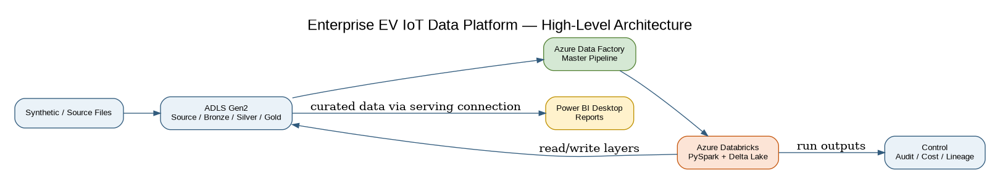
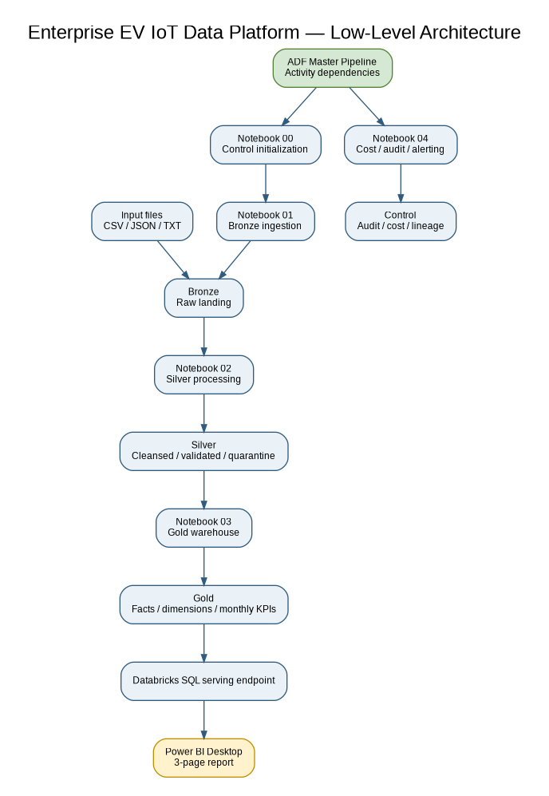
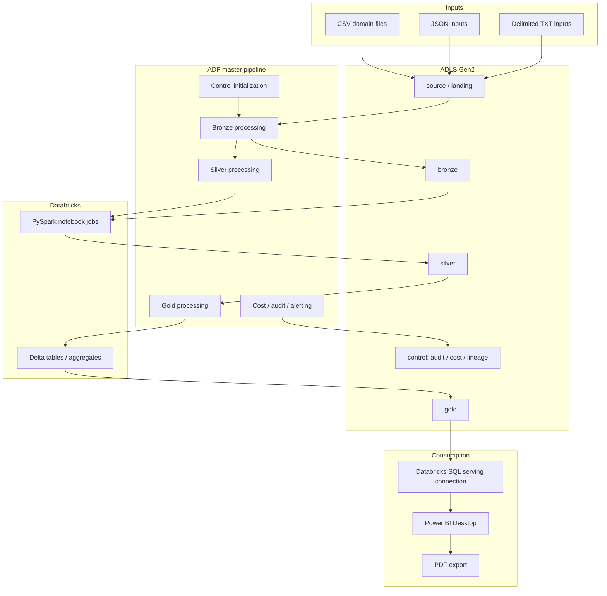
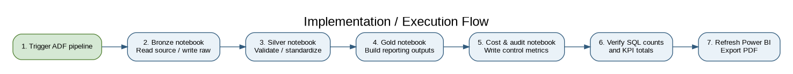
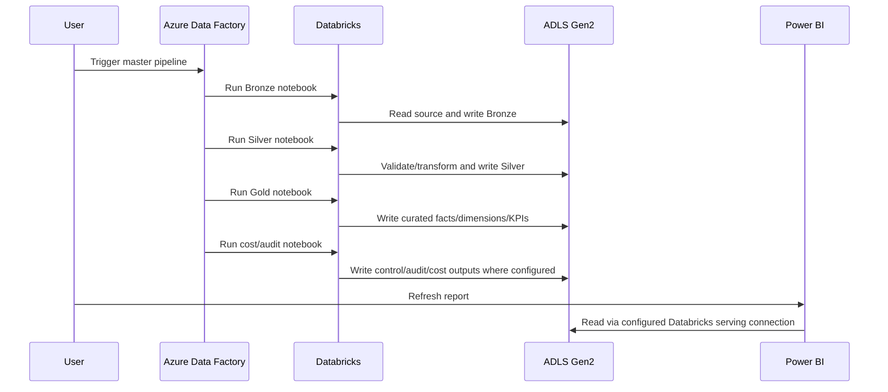

# 2. Architecture

## 2.1 High-level flow

Source/sample files → ADLS Gen2 → ADF orchestration → Databricks notebooks → Bronze/Silver/Gold datasets → Power BI.

## 2.2 High-level component responsibilities
- **Source files:** synthetic datasets representing EV telemetry and related business domains.
- **ADLS Gen2:** durable storage for raw and curated files/tables. The project uses medallion-style containers/folders.
- **Azure Data Factory:** coordinates the notebook activities in the master pipeline.
- **Databricks / PySpark:** performs ingestion, transformation, aggregation and table-writing operations.
- **Delta Lake:** supports Delta-formatted outputs where configured in the notebooks.
- **Control/audit:** stores run/audit/cost-related outputs where implemented.
- **Power BI Desktop:** connects to reporting tables and renders report pages.

## 2.3 Low-level architecture

## 2.4 Implementation/execution diagram

## 2.5 Medallion layers
- **Bronze:** raw or minimally processed source records.
- **Silver:** cleaned/standardized records and domain-oriented outputs; quarantine behaviour depends on notebook logic.
- **Gold:** business-ready fact, dimension and aggregate outputs for analytics.
- **Control:** run metadata, audit, cost and lineage information where implemented.

## 2.6 Identity and networking
The architecture depends on correctly configured Databricks workspace permissions, ADLS access, ADF linked services and Power BI connectivity. Configure these in the Azure environment; do not put secrets in repository files.
