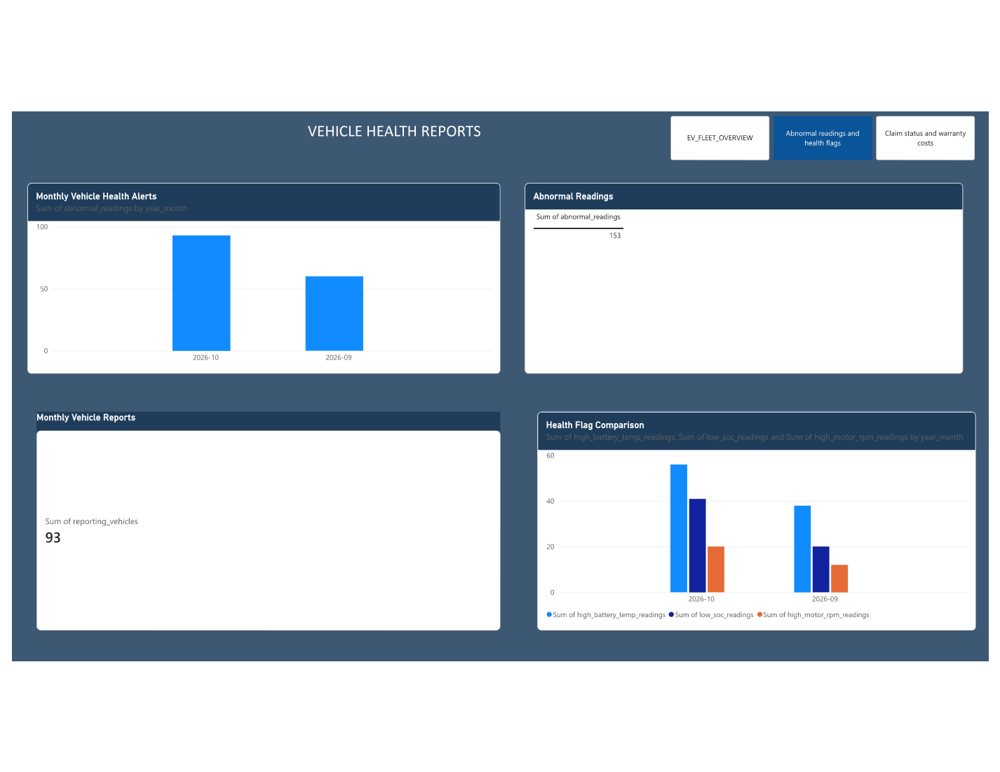
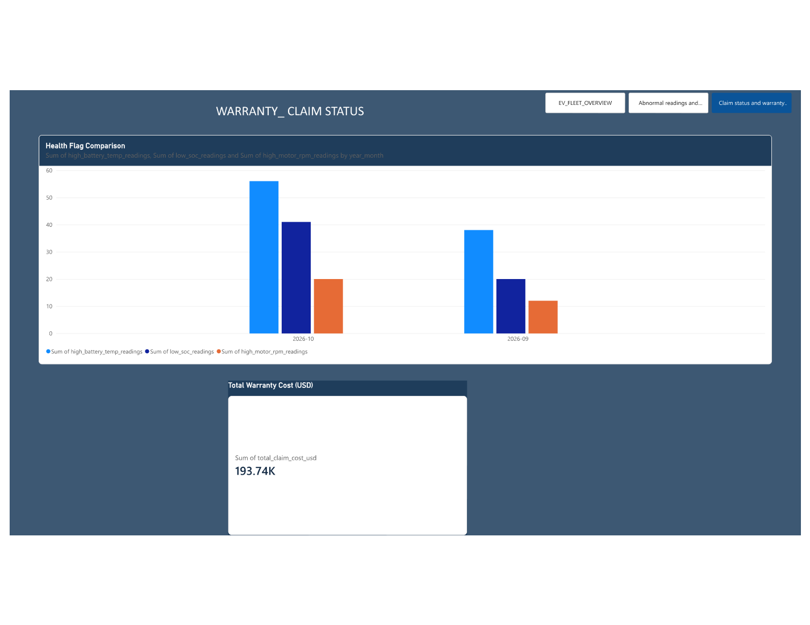

# 5. Power BI Report

## 5.1 Files
- Editable report: `../reports/powerbi/Enterprise_EV_IoT_Dashboard.pbix`
- PDF export: `../reports/powerbi/Enterprise_EV_Fleet_Intelligence_Report.pdf`
- Rendered page images: `../outputs/powerbi_pdf_pages/`

## 5.2 Report pages in the supplied PDF
### Page 1 — EV Fleet Intelligence
Shows the Telemetry Events card (300), Monthly Vehicle Reports card (93), Abnormal Readings card (153), Total Warranty Cost card (193.74K USD), Monthly Telemetry Activity, Monthly Vehicle Health Alerts, Health Flag Comparison, and Warranty Claims Cost by Status.

### Page 2 — Vehicle Health Reports
Shows monthly vehicle-health alerts, abnormal readings, monthly vehicle reports and health-flag comparison.

### Page 3 — Warranty Claim Status
Shows the health-flag comparison chart and total warranty cost card.

> The supplied PDF's third page title is “WARRANTY_CLAIM STATUS”, but its visible charts include health-flag comparison and total warranty cost. This documentation preserves what the screenshot shows rather than assuming the page is exclusively a claim-status analysis.

## 5.3 Refresh workflow
1. Open the PBIX in Power BI Desktop.
2. Go to data source settings and configure the correct Databricks server hostname and HTTP path.
3. Authenticate using your approved connection method; never store a PAT in Git.
4. Refresh and inspect all pages.
5. Check totals against Databricks SQL queries.
6. Export to PDF and replace the reference PDF only after verifying the new export.

## 5.4 Visual design
The report uses a dark navy background, white KPI cards, blue chart bars and section titles. Keep the KPI labels business-friendly and use consistent units. For an improved presentation, rename technical field labels such as `sum_of_telemetry_events` to “Telemetry Events” and format currency as USD.
