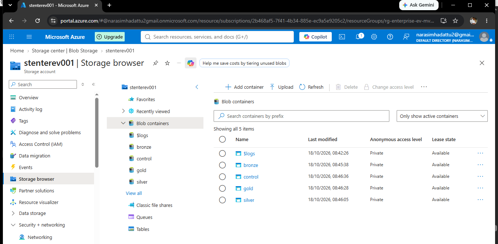
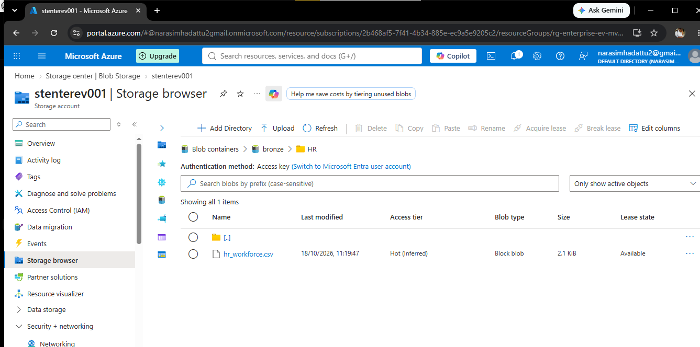
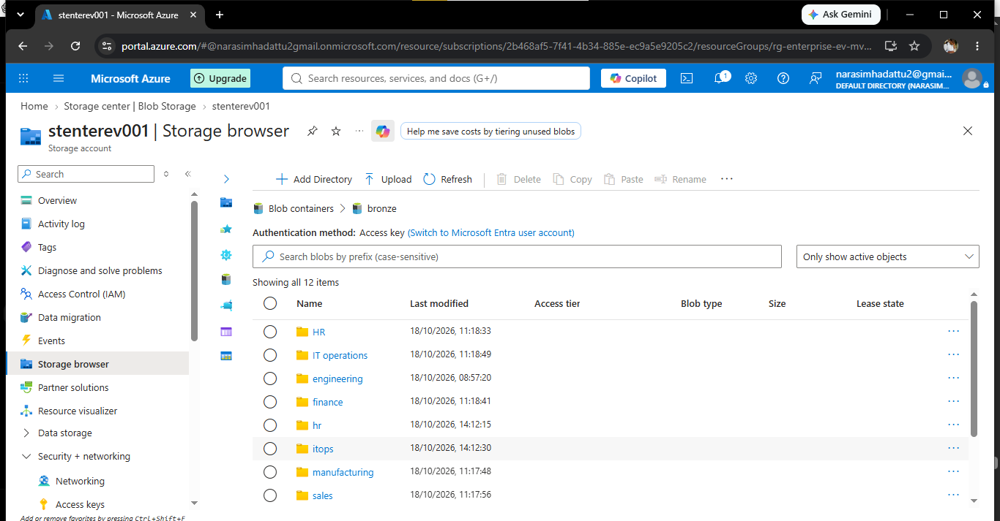
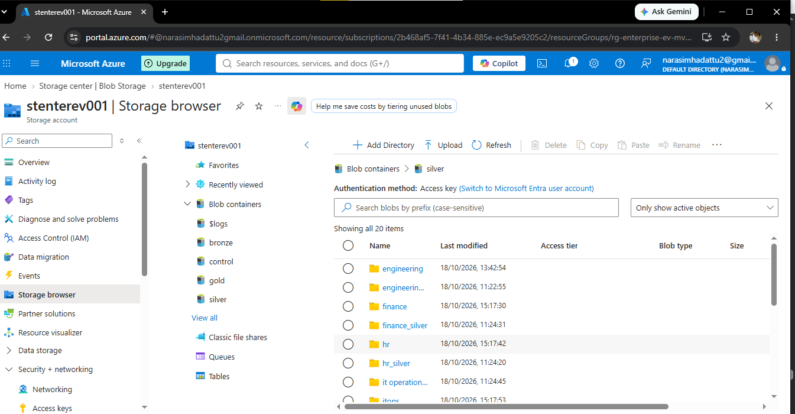
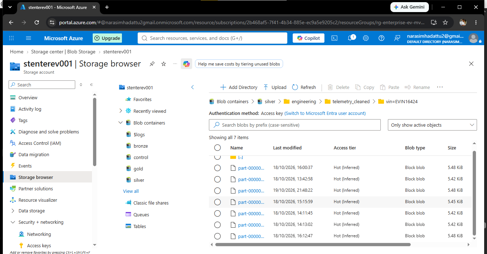
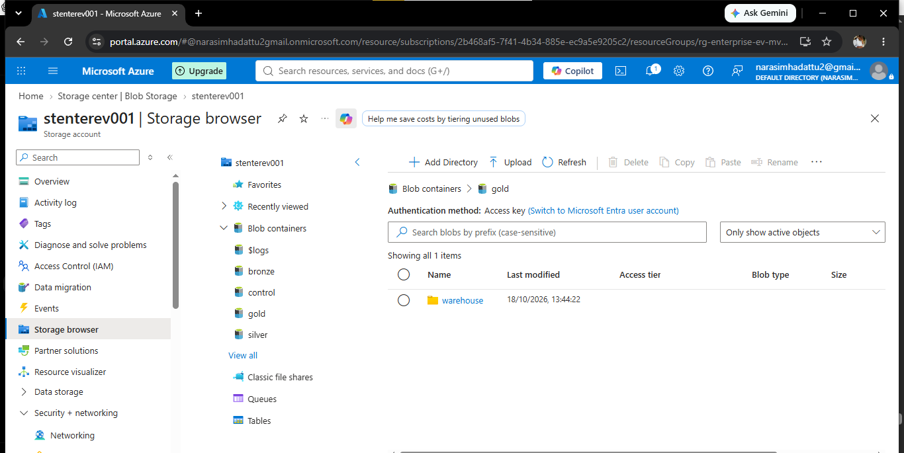
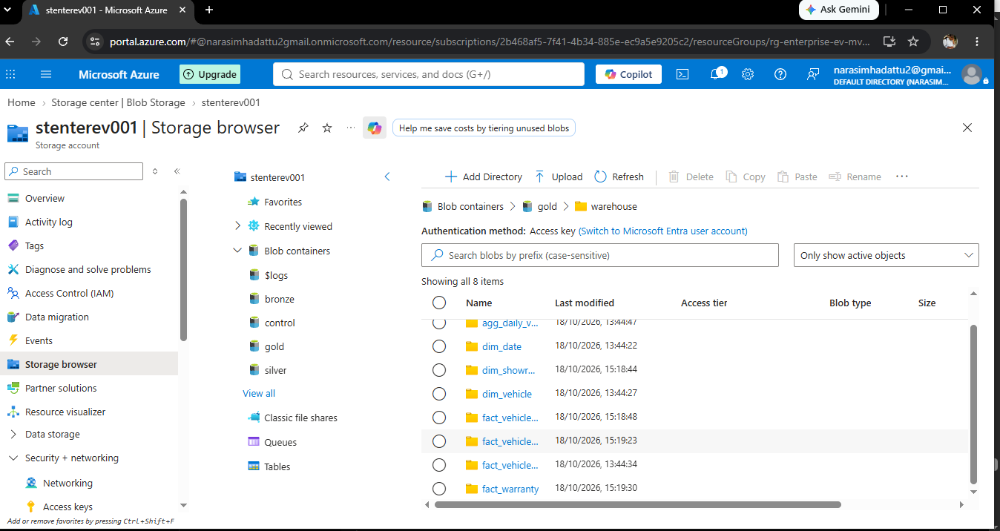
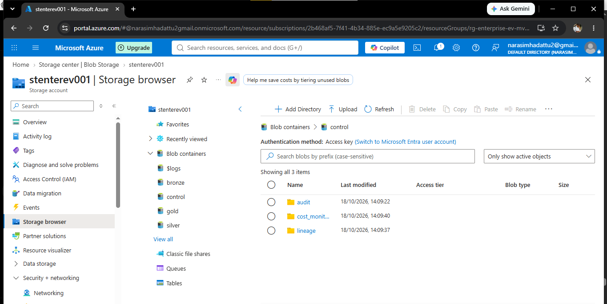

# ADLS Gen2 Storage Evidence

This folder contains screenshots of the Azure Data Lake Storage Gen2 layout used by the Enterprise EV Data Platform.

## Storage containers

The screenshot shows the `bronze`, `silver`, `gold`, and `control` containers. The storage account and resource identifiers visible in screenshots should be reviewed before publishing the repository publicly.

## Bronze layer — source CSV files

Bronze contains source/raw data organized into business-domain folders. Treat the contents as raw/landing data, before Silver cleansing.

## Silver layer — cleansed and transformed data

These screenshots show domain-oriented folders and output files in Silver. File names and folder paths should be checked against the current notebooks if documenting exact table/file contracts.

## Gold layer — analytics-ready outputs

The screenshots show Gold warehouse outputs, including folders corresponding to dimension, fact, and aggregate datasets. The exact visible names may be truncated in the Azure portal; use notebook code or a full listing for definitive names.

## Control layer

The control container is organized into audit, cost-monitoring, and lineage folders, as shown in the Azure portal screenshot.

## Notes before publishing

- Screenshots are implementation evidence, not a substitute for the source code or schema documentation.
- Confirm no secrets, access keys, SAS tokens, connection strings, personal data, or sensitive tenant details are visible.
- Avoid publishing large or confidential source datasets; prefer small synthetic CSV samples under `data/samples/`.
- Azure resource names and timestamps can be environment-specific.
